# Phase 1: Building a SOC Lab, Simulating an Attack, and Detecting It

**Status:** Complete

A step-by-step record of how I built a two-machine Security Operations Center lab with
**Wazuh** (open-source SIEM + EDR), attacked it, and investigated what it caught.
I've included the problems I hit along the way and how I fixed them, because
troubleshooting was a big part of the work.

**Why Wazuh:** Many managed SOCs run an EDR such as SentinelOne, which isn't available
for personal use. Wazuh follows the same model: an **agent** on each endpoint sends
telemetry to a **central manager** that correlates events into alerts mapped to
MITRE ATT&CK.

| Component | Role |
|---|---|
| **Wazuh-Manager** (Ubuntu Server 26.04) | Wazuh manager, indexer (alert database), and dashboard |
| **Endpoint-01** (Ubuntu Server 26.04) | Monitored machine running the Wazuh agent; target of the simulated attack |
| **VirtualBox** on Windows 11 | Hypervisor; both VMs on an isolated NAT network |

**Jump to:** [Part A: Manager](#part-a-build-the-manager) ·
[Part B: Endpoint](#part-b-add-a-monitored-endpoint) ·
[Part C: Attack and detection](#part-c-simulate-an-attack-and-investigate) ·
[Part D: Active response](#part-d-automated-response) ·
[Lessons learned](#lessons-learned)

---

## Part A: Build the manager

### Step 1: Create the manager VM

I created a VirtualBox VM from the Ubuntu Server ISO with **4 GB RAM, 2 CPUs, and a
50 GB disk** (Wazuh's indexer needs at least 4 GB), and used unattended installation to
speed up the OS setup.

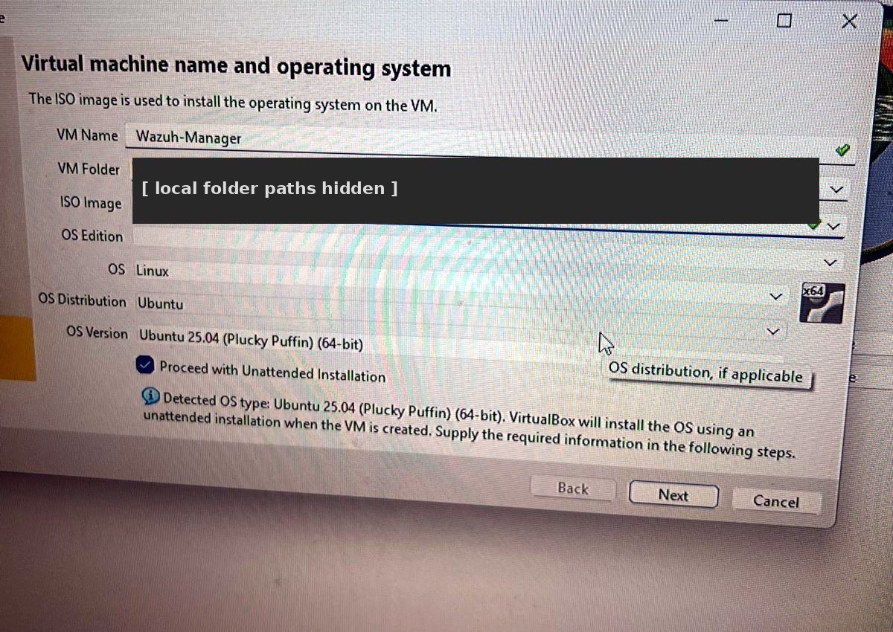

### Step 2: Problem: VirtualBox crashed during installation

Partway through the install, VirtualBox crashed with a memory error.

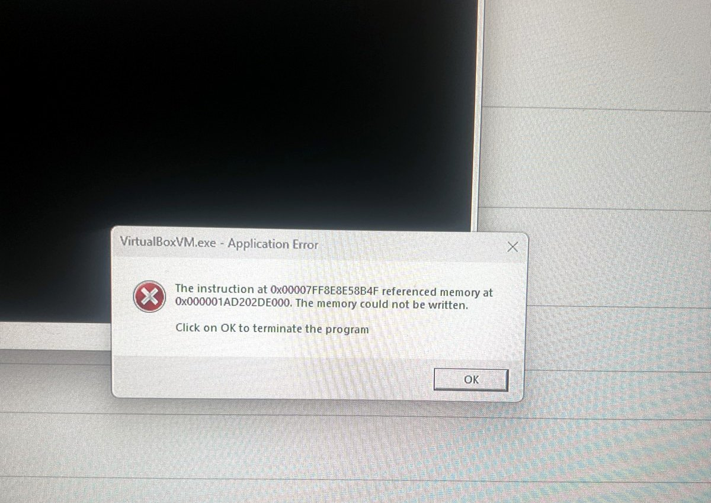

On Windows 11 this is commonly caused by conflicts with Hyper-V or Memory Integrity,
which compete with VirtualBox for hardware virtualization. Despite the crash, the VM
had finished installing and booted normally afterward.

### Step 3: Ubuntu installed and updated

I logged in to the new server and brought it fully up to date:

```bash
sudo apt update && sudo apt upgrade -y
```

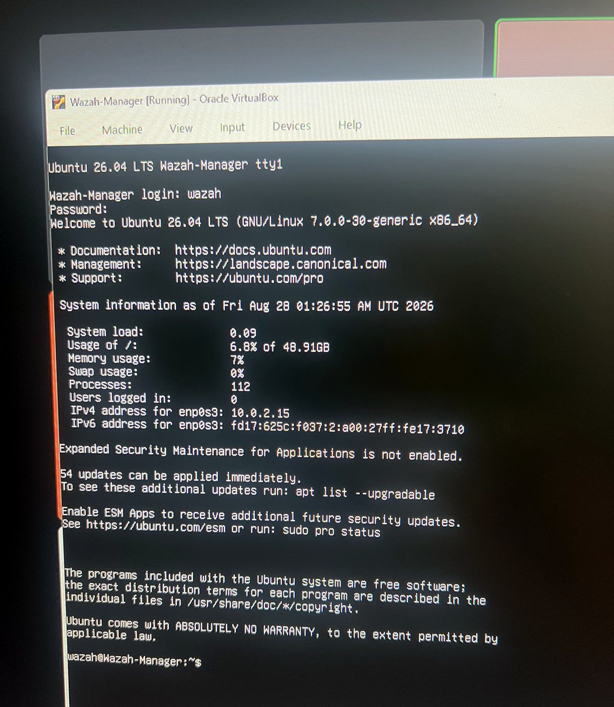

### Step 4: Download the Wazuh installer

```bash
curl -O https://packages.wazuh.com/4.9/wazuh-install.sh
ls -la wazuh-install.sh
```

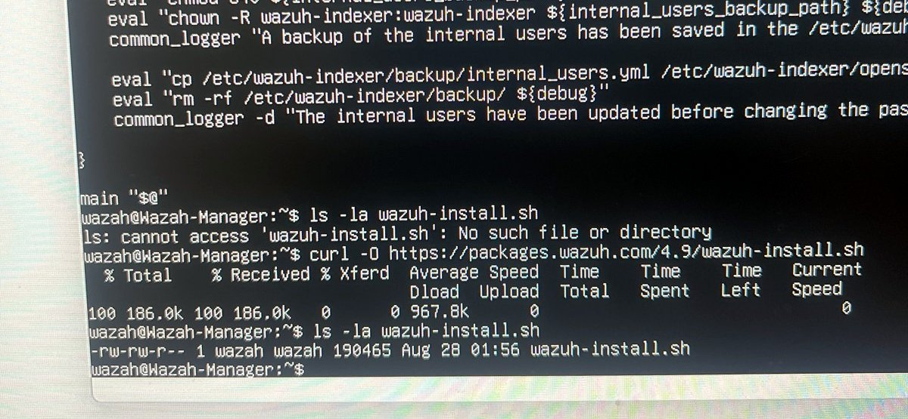

**Problem:** My first few attempts failed because of small typos: a misspelled domain
(`wazah` instead of `wazuh`) and a missing `-O` flag, which made curl print the whole
script to the screen instead of saving it. I fixed it by slowing down and verifying the
file with `ls` before running anything.

### Step 5: Problem: the installer rejected my OS

```bash
sudo bash ./wazuh-install.sh -a
```

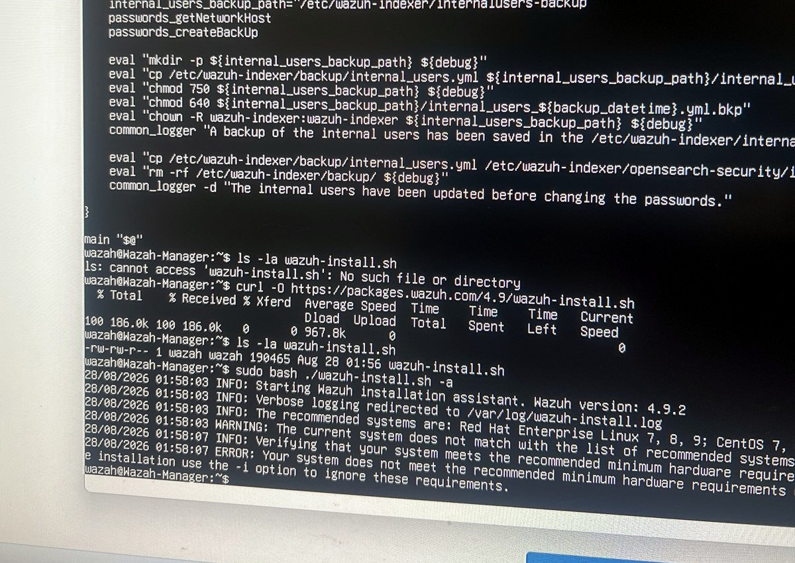

The installer checks against a list of "recommended" systems, and my Ubuntu release
wasn't on it. The error message suggested the fix: the `-i` flag skips that check.

```bash
sudo bash ./wazuh-install.sh -a -i
```

### Step 6: Installation complete

The all-in-one install (`-a`) set up the **indexer, manager, Filebeat, and dashboard**.

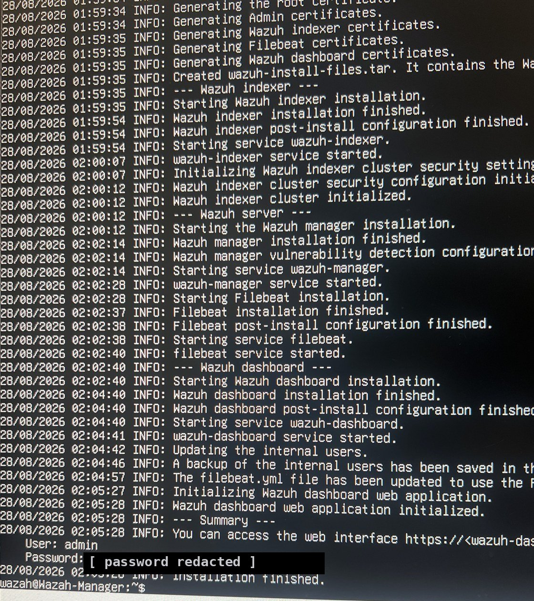

The installer prints an auto-generated admin password once. It also saves every
credential in `wazuh-install-files.tar`, which I relied on later. *(Password redacted
in the screenshot.)*

### Step 7: Problem: the dashboard wasn't reachable from my host

Opening the VM's address in my Windows browser timed out. VirtualBox's default **NAT**
mode lets a VM reach the internet but blocks the host from connecting **into** the VM.
I added a port-forwarding rule so `https://localhost` on Windows reaches port 443
on the VM:

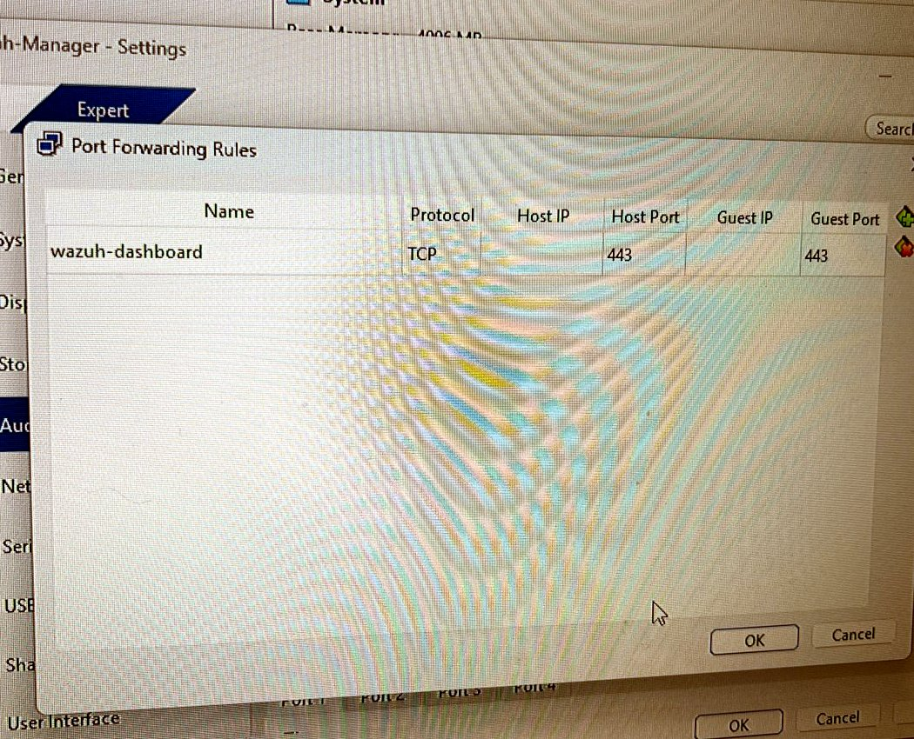

### Step 8: Dashboard live

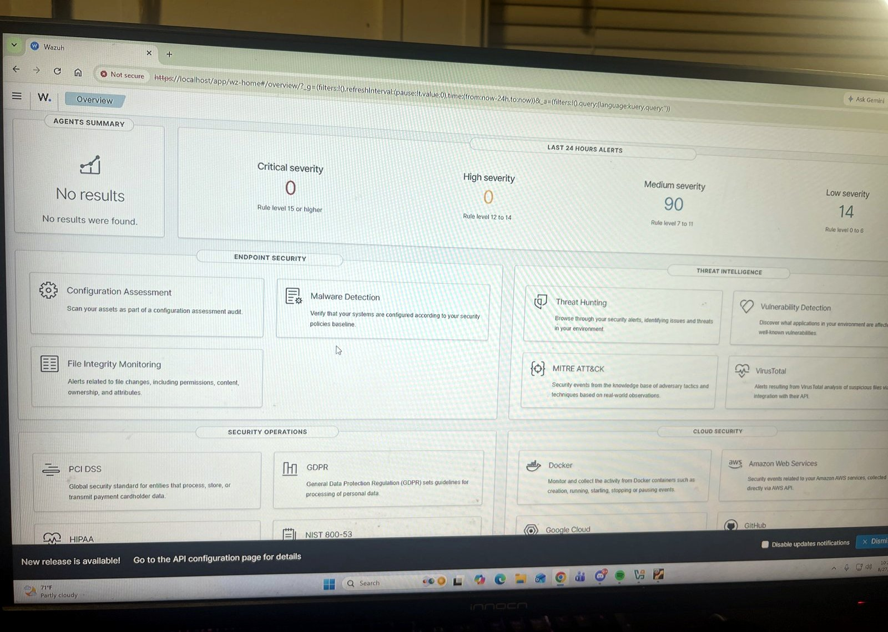

The dashboard loaded, but showed no agents yet, because nothing was being monitored.

---

## Part B: Add a monitored endpoint

### Step 9: Create Endpoint-01, then fix the network

I built a second Ubuntu Server VM (2 GB RAM, 25 GB disk) to act as the monitored machine.

**Problem:** Both VMs received the **same IP address** and couldn't reach each other.
In plain NAT mode, each VM gets its own private, isolated network.

**Fix:** I created a shared **NAT Network** in VirtualBox's Network Manager and switched
each VM's adapter from *NAT* to *NAT Network*. Each VM got a unique address on the
same network. Because NAT Networks handle port forwarding at the network level, I
recreated the dashboard rule there and pointed it at the manager's new address.

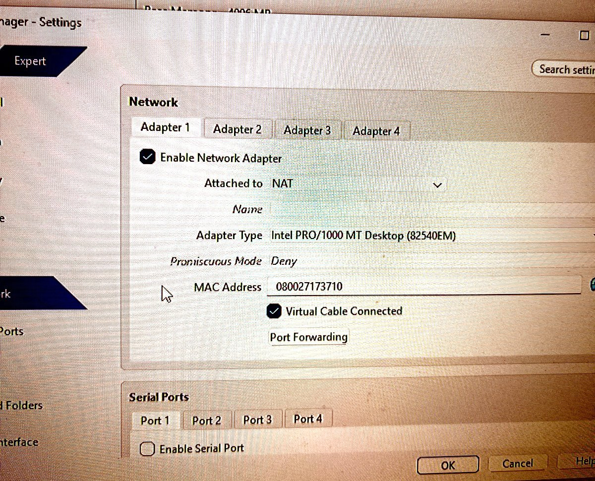

### Step 10: Install the Wazuh agent

On Endpoint-01, I downloaded the agent and installed it with the manager's address
built in, so it knows where to send its data:

```bash
curl -so wazuh-agent.deb https://packages.wazuh.com/4.x/apt/pool/main/w/wazuh-agent/wazuh-agent_4.9.2-1_amd64.deb
sudo WAZUH_MANAGER='<manager-ip>' dpkg -i ./wazuh-agent.deb
```

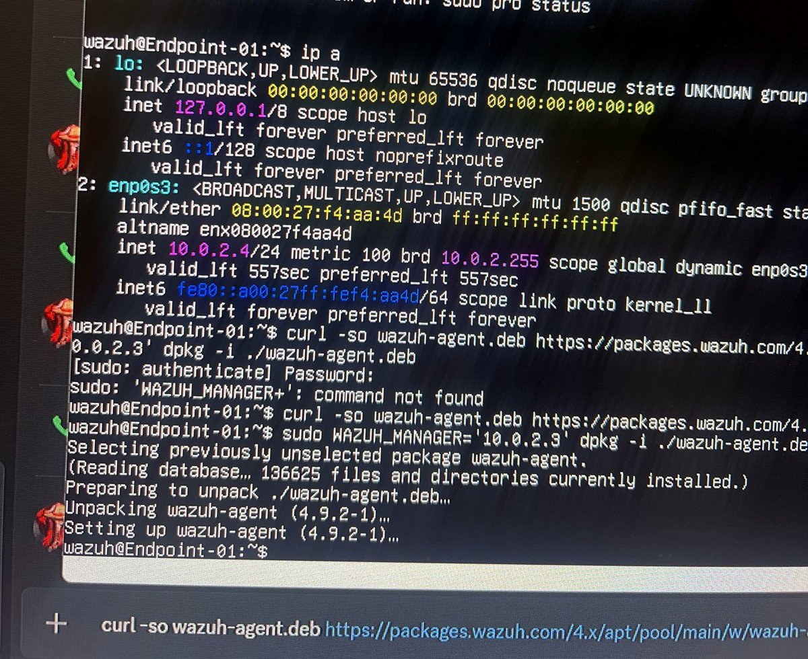

**Problem:** My first attempt failed with `WAZUH_MANAGER+: command not found`. A stray
character broke the variable assignment. Splitting the download and install into two
separate commands made each easier to check.

### Step 11: Start the agent

```bash
sudo systemctl daemon-reload
sudo systemctl enable wazuh-agent
sudo systemctl start wazuh-agent
sudo systemctl status wazuh-agent
```

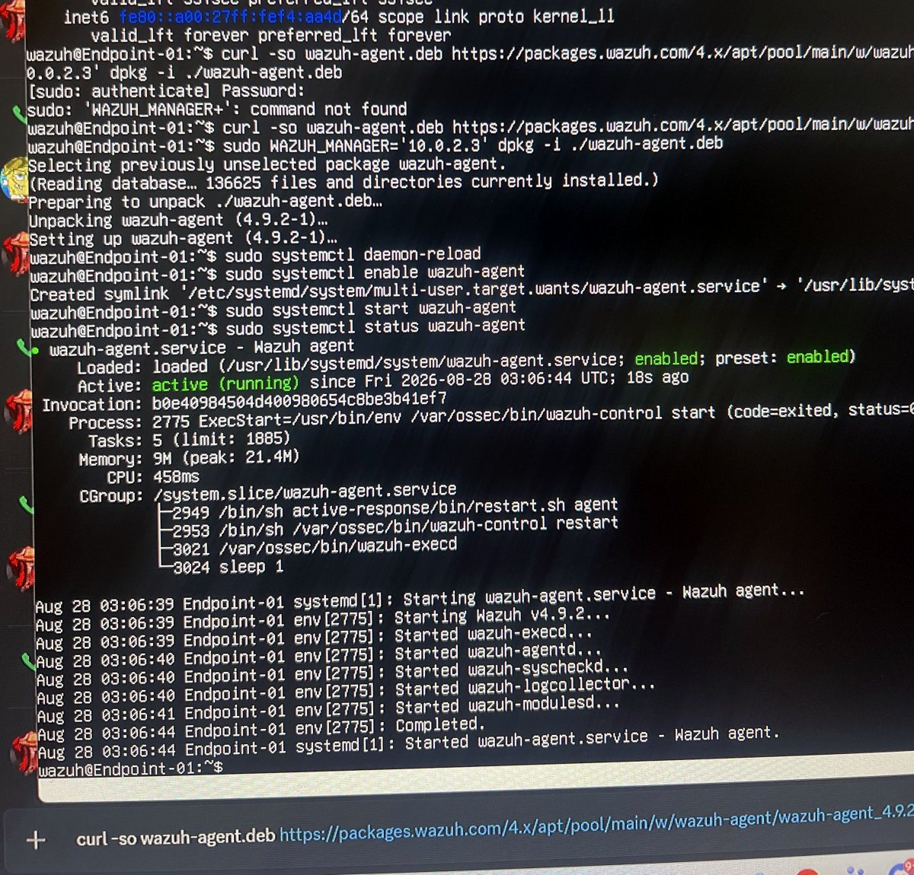

All agent modules started: `wazuh-agentd`, `wazuh-execd`, `wazuh-syscheckd` (file
integrity), `wazuh-logcollector`, and `wazuh-modulesd`.

### Step 12: Agent confirmed in the dashboard

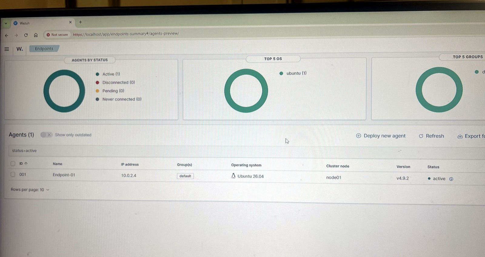

**Endpoint-01 showed as Active.** At this point I had a working two-machine SOC
environment: one endpoint reporting telemetry to a central manager.

---

## Part C: Simulate an attack and investigate

### Step 13: Simulate an SSH brute-force attack (MITRE T1110)

My first attempt returned `Connection refused`. There was **no SSH server** on the
endpoint, so the login attempts never reached authentication and left nothing to detect.
I installed and started OpenSSH, then repeatedly tried to log in as a user that doesn't
exist:

```bash
sudo apt install openssh-server -y
sudo systemctl enable --now ssh
for i in {1..8}; do ssh fakeuser@localhost; done
```

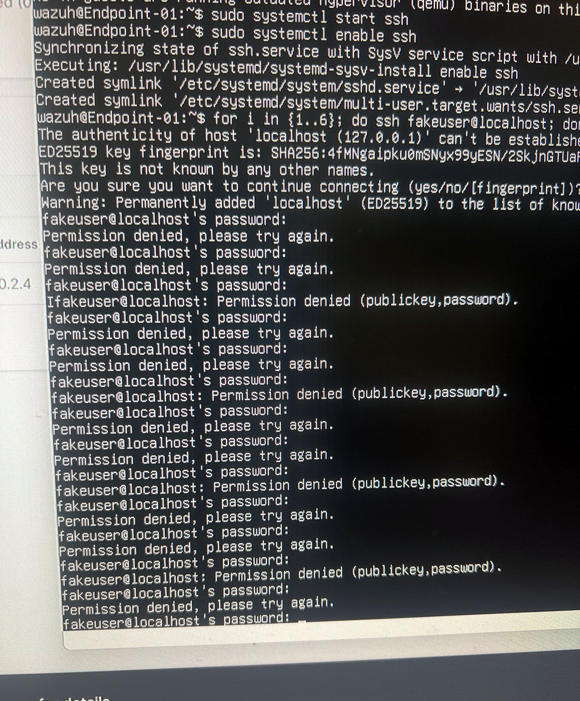

### Step 14: Investigate in Threat Hunting

Wazuh recorded **99 events** from the attack. Individual low-severity events escalated
into one correlated high-severity alert:

| Rule | Description | Level |
|---|---|---|
| 5710 | sshd: attempt to login using a non-existent user | 5 |
| 5503 | PAM: user login failed | 5 |
| 2502 | syslog: user missed the password more than one time | 10 |
| **5712** | **sshd: brute force trying to get access to the system** | **10** |

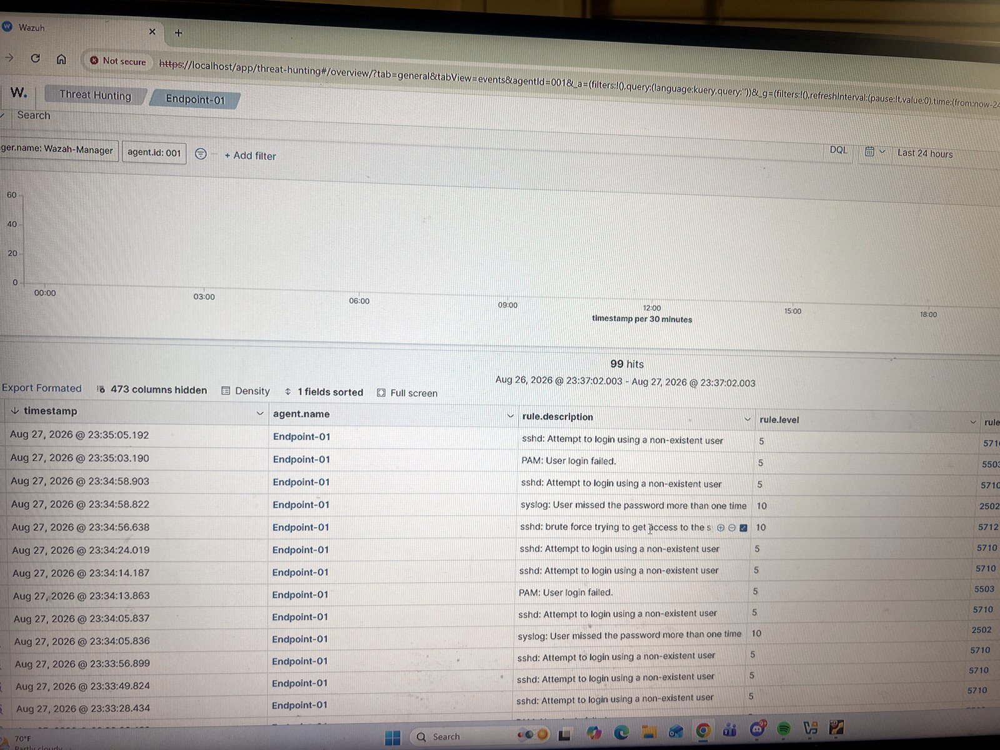

### Step 15: Understand why rule 5712 fired

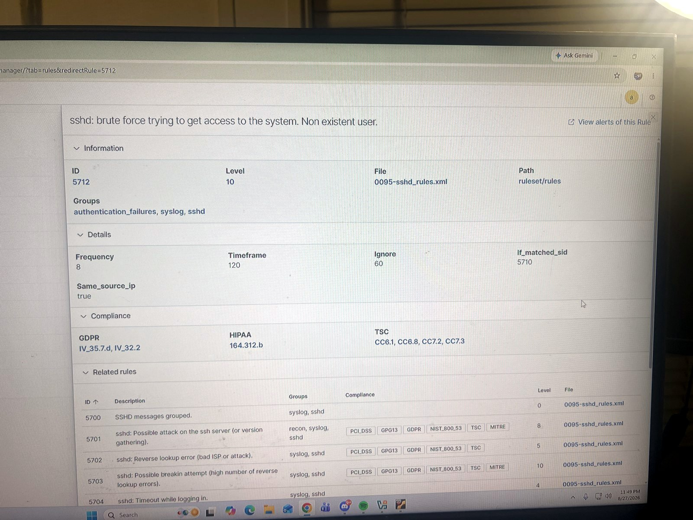

- **Logic:** fires when rule 5710 matches **8 times within 120 seconds from the same source IP** (`frequency: 8`, `timeframe: 120`, `same_source_ip`)
- **Compliance mapping:** GDPR (IV_35.7.d, IV_32.2), HIPAA (164.312.b), TSC (CC6.1, CC6.8, CC7.2, CC7.3)
- **MITRE ATT&CK:** T1110, Brute Force (Credential Access)
- **Triage verdict:** **True positive.** Rapid, repeated failures against an invalid account from one source matches a credential-guessing attack.

This is the core value of a SIEM: a single failed login is noise, but a correlated
pattern is a signal.

### Step 16: Finding: a File Integrity Monitoring gap

To test file integrity monitoring (FIM), I created files in two directories attackers
commonly use for persistence:

```bash
sudo touch /etc/malicious_test_file.txt
sudo touch /root/suspicious_script.sh
```

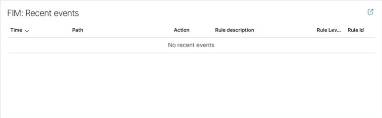

**No FIM alerts were generated.** Two default settings explain it:
- `/root` isn't in Wazuh's default list of monitored directories.
- `/etc` is monitored, but only by a **scheduled scan** (every 12 hours by default), not in real time.

In a real environment, an attacker's dropped script could go unnoticed for hours, or
entirely. The fix is to add high-value directories to the `<syscheck>` configuration
with `realtime="yes"`.

This was a useful lesson: **verify that a control actually works instead of assuming
it does.**

### Step 17: Endpoint overview

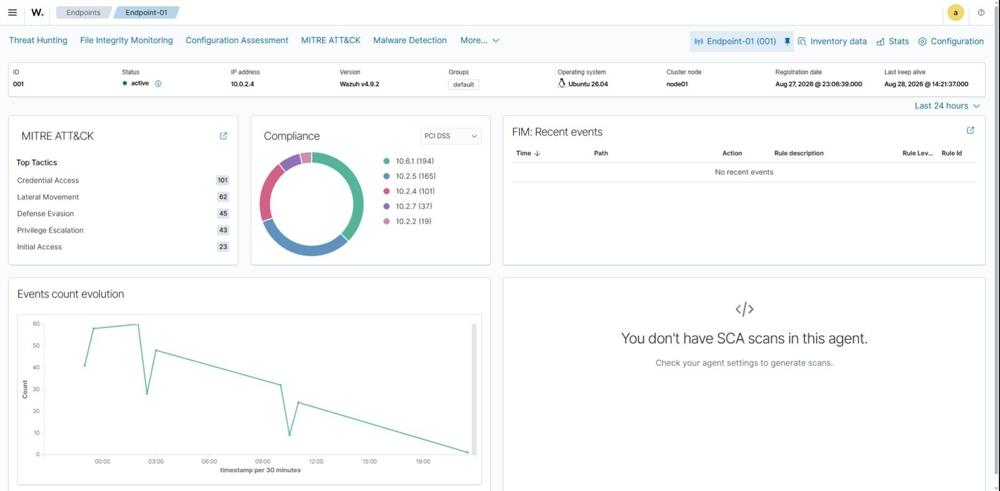

The endpoint view summarizes activity by MITRE ATT&CK tactic (Credential Access was the
top tactic, from the brute-force test) and by compliance requirement.

---

## Part D: Automated response

### Step 18: Configure active response

Detection alone isn't enough, so I configured Wazuh to **automatically block** the
source of a brute-force attack. In the manager's `/var/ossec/etc/ossec.conf`:

```xml
<ossec_config>
  <command>
    <name>firewall-drop</name>
    <executable>firewall-drop</executable>
    <timeout_allowed>yes</timeout_allowed>
  </command>

  <active-response>
    <command>firewall-drop</command>
    <location>local</location>
    <rules_id>5712</rules_id>
    <timeout>300</timeout>
  </active-response>
</ossec_config>
```

When rule 5712 fires, this should run `firewall-drop` on the endpoint to block the
attacking IP for 300 seconds.

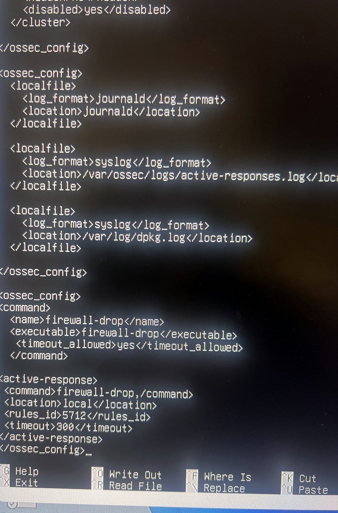

**Problem:** My first edits broke the XML: duplicate closing tags, a misspelled tag, and
a comma where a `<` belonged. I fixed them one at a time, then confirmed the config was
valid when the manager restarted cleanly.

### Step 19: Test: partially validated

I re-ran the attack and checked whether the block actually happened:

```bash
sudo cat /var/ossec/logs/active-responses.log
sudo iptables -L -n
```

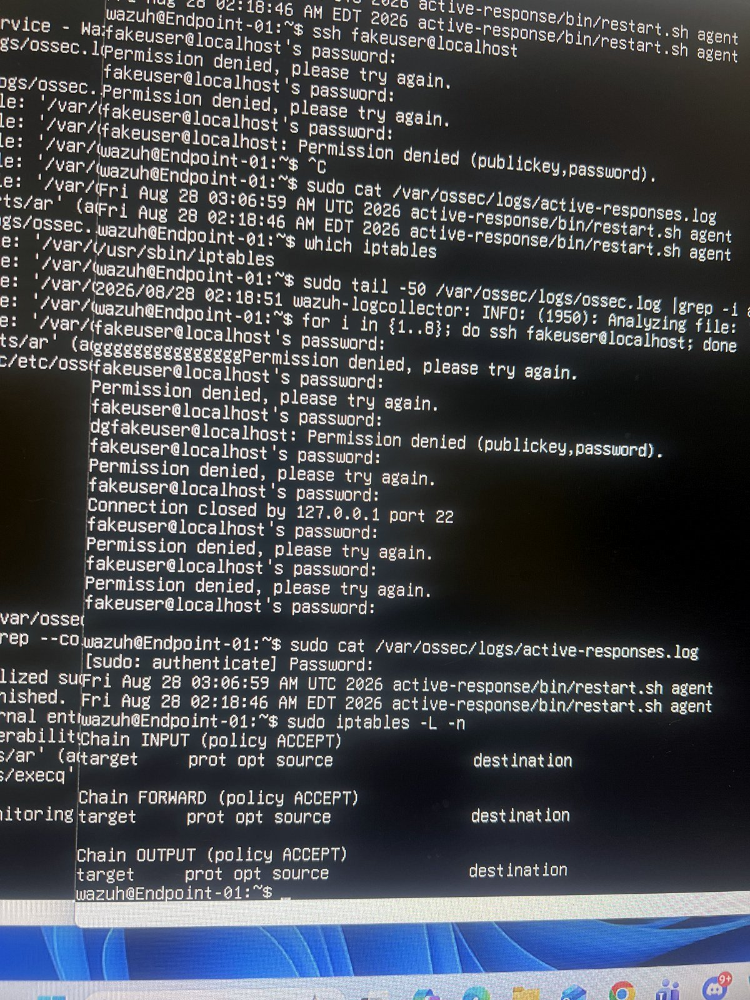

**Result:** Rule 5712 fired again, and the manager's active-response queue was
connected, but **no firewall rule was created** on the endpoint. The log showed only
agent restarts. One SSH session was closed mid-attack, but that came from OpenSSH's
own limit on authentication attempts, not from Wazuh.

**Status:** The configuration loads and the dispatch pipeline is live, but end-to-end
blocking isn't confirmed yet. Next I would check agent-side remote command permissions
and trigger a manual test with `agent_control` to isolate whether the gap is in
dispatching the command or executing it. I'm documenting this honestly rather than
calling it a success.

---

## Lessons learned

1. **Correlation turns noise into signal.** Dozens of individual failed logins became one actionable high-severity alert.
2. **Verify controls instead of trusting defaults.** FIM didn't catch files in /etc or /root out of the box.
3. **Detection and response are separate problems.** Getting an alert is not the same as stopping the attacker.
4. **Read the error message.** The installer's OS check and many of my typos were solved by reading the output carefully.
5. **Networking is half the work.** NAT vs. NAT Network and port forwarding took as long as installing the security tools.

The full write-up, including timeline, MITRE mapping, and remediation recommendations,
is in the **incident report** in this repository's `docs` folder.
