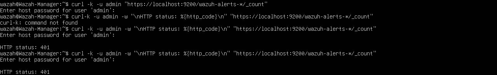

# Phase 2: Automating Alert Retrieval with Python and the Wazuh API

**Status:** In progress

## Goal

Security platforms are not only used through their dashboards. Analysts also query them
with code to automate reporting, tuning, and threat hunting. Managed SOCs commonly do
this with Python and the SentinelOne API.

I don't have access to SentinelOne, so I practiced the same pattern against the
**Wazuh indexer API** in my existing lab: query the platform programmatically, then
turn the results into a client-style security report.

**Planned outcome:** a Python script that pulls recent alerts and produces a report with:
- Alert totals and severity breakdown
- Top triggered rules and source IPs
- A "noisiest rules" section with tuning recommendations

## Lab context

| Component | Detail |
|---|---|
| Manager | Wazuh-Manager (Ubuntu 26.04) |
| Alert database | Wazuh indexer, HTTPS on port 9200 |
| Monitored endpoint | Endpoint-01 (Ubuntu 26.04) |
| Network | Isolated VirtualBox NAT network |

---

## Step 1: Query the indexer API by hand with curl

Before writing any code, I confirmed the API works and that I understand the request.

```bash
curl -k -u admin "https://localhost:9200/wazuh-alerts-*/_count"
```

| Part | Purpose |
|---|---|
| `curl` | Sends an HTTP request from the terminal |
| `-k` | Accepts the lab's self-signed TLS certificate |
| `-u admin` | Authenticates as the indexer admin user (password prompted, not typed into the command) |
| `localhost:9200` | The Wazuh indexer, the database where every alert is stored |
| `wazuh-alerts-*` | All daily alert indices |
| `_count` | Returns the number of stored alerts |

### Troubleshooting: HTTP 401 Unauthorized

The first attempt returned an empty response. To see what the server actually said, I
added `-w` to print the HTTP status code:

```bash
curl -k -u admin -w "\nHTTP status: %{http_code}\n" "https://localhost:9200/wazuh-alerts-*/_count"
```



**401 means the request reached the indexer, but authentication failed.** That ruled out
networking and a stopped service, and narrowed the problem to the credential.

The admin password is randomly generated during installation. Instead of relying on a
copy, I retrieved it from the source: the installer stores credentials in
`wazuh-install-files.tar`. I printed only the password file, without extracting the
archive:

```bash
sudo tar -O -xf wazuh-install-files.tar wazuh-install-files/wazuh-passwords.txt
```

Two small mistakes slowed me down: typing the number `0` instead of the letter `O` in
`-O`, and misspelling the archive name. I fixed both by using **Tab completion**, which
only completes names that actually exist.

### Result


```json
{"count":645,"_shards":{"total":9,"successful":9,"skipped":0,"failed":0}}
```

- **645 alerts** stored in the lab, including my SSH brute-force simulations
- **9 of 9 shards responded, 0 failed**, so the indexer is healthy

### What I learned

- An API lets a program ask a security platform questions directly. The dashboard is just one client of the same data.
- **HTTP status codes are a fast diagnostic tool:** 200 = OK, 401 = bad credentials, 503 = service not ready, 000 = no connection.
- Go to the source of truth for credentials instead of an old copy.

---

## Step 2: The same query in Python

*In progress.*

---

## Security practices

- **No passwords in code or in this repository.** The script prompts for the password at runtime with `getpass`, so it's never saved in a file.
- **Screenshots are cropped** so no credentials appear.
- `verify=False` / `-k` are acceptable only because this is an isolated lab with a self-signed certificate. In production, I would trust the certificate properly instead of disabling verification.
